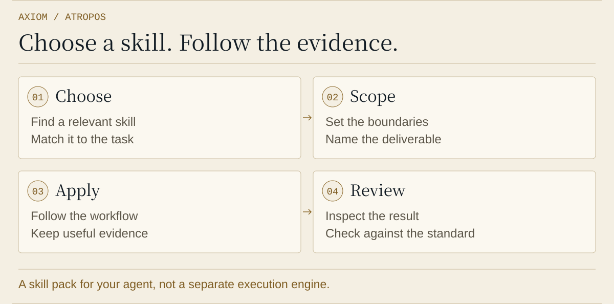

<p align="center"></p>

<h1 align="center"><picture><source media="(prefers-color-scheme: dark)" srcset="https://raw.githubusercontent.com/xinhi6716/xinhi6716/443d48c713f27d52656ad8ea3cb4c5bb9c7dd440/assets/brand-marks/v1/atropos-icon-dark.svg"></picture> Axiom Atropos</h1>

<p align="center"><strong>Research and engineering skills for your existing agent.</strong></p>

<p align="center"><strong>English</strong> · <a href="README.zh-TW.md">繁體中文</a> · <a href="README.zh-CN.md">简体中文</a></p>

<p align="center"><a href="#install">Install</a> · <a href="#begin">Choose a workflow</a> · <a href="#boundaries">Limits</a></p>

**66 research and engineering workflows** for your agent. Choose a skill, define its checks and review the evidence.

| Your task | Start here |
| --- | --- |
| Research a question | [Research suite](skills/research-suite/SKILL.md) |
| Change a codebase | [Poteto mode](skills/poteto-mode/SKILL.md) |
| Check your host | [Compatibility and verification](docs/compatibility.md) |

<a id="install"></a>
<a id="install-for-your-host"></a>

## Install the Rust prerelease

Download the matching Windows x86-64 or Linux x86-64 archive and SHA-256 checksum from [Releases](https://github.com/xinhi6716/axiom-atropos/releases). Verify, extract, and run `bin/atropos install --host codex` (Windows: `bin/atropos.exe`). Supported hosts: `codex`, `claude`, `deepseek`, `antigravity`, `pi`. Use `--update` when updating Claude.

The native core needs no Python, Node or Bun. Codex/Claude registration needs the host CLI. Plugin identity remains `axiom-forge`. Installation uses a versioned local marketplace or managed skill directory and preserves user edits. Add the extracted `bin` directory to PATH for skill helpers.

Source build: `cargo build --release --locked`. [Runtime commands, migration boundary and verification](docs/rust-runtime.md).

<a id="begin"></a>
<a id="what-are-you-working-on"></a>

## Choose a workflow

**Research:** [research-suite](skills/research-suite/SKILL.md) routes a question to literature search, hypothesis design, statistical analysis and evidence critique.

> Use research-suite to investigate this question. Choose the skills it needs and state what evidence would change the conclusion.

**Engineering:** [poteto-mode](skills/poteto-mode/SKILL.md) brings Pstack planning, implementation, review and verification to a code change.

> Use poteto-mode to investigate this bug. Reproduce the failure and explain how you will check the fix.

Load the skills you need, rather than all 66. Individual research skills can also be used directly; not every task needs a coordinator.

<a id="evidence"></a>
<details>
<summary><strong>Workflow and advanced tools</strong></summary>

<p align="center"><picture>
  <source media="(prefers-color-scheme: dark) and (max-width: 600px)" srcset="assets/atropos-process-dark-mobile.svg" />
  <source media="(max-width: 600px)" srcset="assets/atropos-process-mobile.svg" />
  <source media="(prefers-color-scheme: dark)" srcset="assets/atropos-process-dark.svg" />
  
</picture></p>

[Native bridge](bridge/README.md) and [agents](agents/) support compatible hosts. The Rust core needs only its backend CLIs. Optional upstream scientific, watcher and statechart helpers retain Python / Node / Java requirements; see the [migration boundary](docs/rust-runtime.md).

</details>

<a id="boundaries"></a>
<a id="before-you-rely-on-it"></a>

## Status and limits

- Skills contain instructions and supporting scripts. Installation does not supply Python, third-party MCP servers, model weights or credentials. RSI is a research method, not a deployed model or self-evolution runtime.
- Host verification differs. Antigravity and Pi have installer tests, not model-session verification. See the [compatibility table](docs/compatibility.md).
- Directory installs stop on same-name conflicts or modified owned content. Native plugin managers own their caches. Personal instructions, model settings and API keys are not edited. Pi’s shared skills directory may also be discovered by other applications.

**Lachesis remains planned.** It is a separate coordinator, not a feature bundled into this pack.

<a id="inside-the-repository"></a>
<details>
<summary><strong>Repository guide</strong></summary>

```text
skills/             66 reusable workflows
pstack-resources/   Shared Pstack references and host mappings
src/                Native Rust CLI, bridge, memory and orchestration
docs/               Compatibility and maintenance
tests/              Native integration tests and compatibility oracles
licenses/           Upstream copyright and MIT notices
```

[Maintenance](docs/maintaining.md) · [Source pins](sources.json) · [Releases](https://github.com/xinhi6716/axiom-atropos/releases)

</details>

---

[MIT License](LICENSE) · [Credits and licenses](licenses/README.md) · [Asset notices](assets/ASSET_NOTICES.txt)

An independent integration of Lauren Tan’s Pstack, LIU-31415’s codex-research and K-Dense scientific skills. Atropos is the Moirai skill pack within Axiom.

