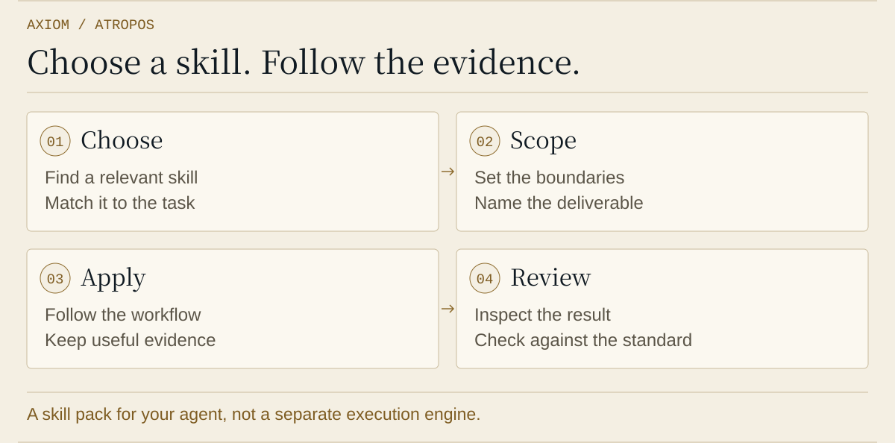

<p align="center"></p>

<h1 align="center"><picture><source media="(prefers-color-scheme: dark)" srcset="https://raw.githubusercontent.com/xinhi6716/xinhi6716/443d48c713f27d52656ad8ea3cb4c5bb9c7dd440/assets/brand-marks/v1/atropos-icon-dark.svg"></picture> Axiom Atropos</h1>

<p align="center"><strong>供现有 agent 使用的研究与工程技能。</strong></p>

<p align="center"><a href="README.md">English</a> · <a href="README.zh-TW.md">繁體中文</a> · <strong>简体中文</strong></p>

<p align="center"><a href="#install">安装</a> · <a href="#begin">选择工作流</a> · <a href="#boundaries">使用限制</a></p>

**66 个研究与工程工作流**，用于你现有的 agent。选择技能、定义检查，再审阅证据。

| 你要做什么 | 从这里开始 |
| --- | --- |
| 研究一个问题 | [Research suite](skills/research-suite/SKILL.md) |
| 修改代码 | [Poteto mode](skills/poteto-mode/SKILL.md) |
| 确认主机支持 | [相容性与验证](docs/compatibility.md) |

<a id="install"></a>
<a id="install-for-your-host"></a>
<a id="选择你的使用环境"></a>

## 安装 Rust 预发行版

从[版本下载](https://github.com/xinhi6716/axiom-atropos/releases)取得 Windows x86-64 或 Linux x86-64 软件包及 SHA-256 校验码。校验、解压后执行 `bin/atropos install --host codex`（Windows 使用 `bin/atropos.exe`）。支持 `codex`、`claude`、`deepseek`、`antigravity`、`pi`；更新或迁移已有安装时加 `--update`。

原生核心不需要 Python、Node 或 Bun；Codex／Claude 安装仍需各自主机 CLI。插件标识保留 `axiom-forge`。安装使用版本化本地 marketplace 或受管理技能目录，保留用户修改。请将解压后的 `bin` 加入 PATH，以使用技能中的原生辅助命令。

从源码构建：`cargo build --release --locked`。[完整命令、移植范围与验证方式](docs/rust-runtime.md)。

<a id="begin"></a>
<a id="what-are-you-working-on"></a>
<a id="你现在要做什么"></a>

## 选择工作流

**研究：**[research-suite](skills/research-suite/SKILL.md) 按问题选用文献检索、假说设计、统计分析与证据评估技能。

> 使用 research-suite 研究这个问题。选用需要的技能，说明哪些证据会改变结论。

**工程：**[poteto-mode](skills/poteto-mode/SKILL.md) 以 Pstack 的规划、实现、审查与验证流程处理代码修改。

> 使用 poteto-mode 调查这个 bug。先复现失败，再说明要如何验证修复。

按需要加载技能，不必一次读全部 66 个。个别研究技能也可直接使用，不是每个任务都需要协调器。

<a id="evidence"></a>
<details>
<summary><strong>流程与进阶工具</strong></summary>

<p align="center"><picture>
  <source media="(prefers-color-scheme: dark) and (max-width: 600px)" srcset="assets/atropos-process-dark-mobile.svg" />
  <source media="(max-width: 600px)" srcset="assets/atropos-process-mobile.svg" />
  <source media="(prefers-color-scheme: dark)" srcset="assets/atropos-process-dark.svg" />
  
</picture></p>

[Native bridge](bridge/README.md) and [agents](agents/) support compatible hosts. The Rust core needs only its backend CLIs. Optional upstream scientific, watcher and statechart helpers retain Python / Node / Java requirements; see the [migration boundary](docs/rust-runtime.md).

</details>

<a id="boundaries"></a>
<a id="before-you-rely-on-it"></a>
<a id="使用前要知道的事"></a>

## 状态与限制

- 技能包含指南与辅助程序；安装不提供 Python、第三方 MCP server、模型权重或凭证。RSI 是研究方法，不是已部署模型或自我进化运行环境。
- 各主机验证程度不同。Antigravity 与 Pi 只有安装程序测试，没有模型会话验证。详见[兼容性表](docs/compatibility.md)。
- 技能目录安装遇到同名冲突或已修改的软件包内容会停止。原生插件管理器维护各自缓存；不修改个人指令、模型设置或 API key。其他应用程序也可能读取 Pi 的共享技能目录。

**Lachesis 仍在规划中。** 它是独立协调器，不是本技能包已附带的功能。

<a id="inside-the-repository"></a>
<a id="仓库导览"></a>
<details>
<summary><strong>仓库导览</strong></summary>

```text
skills/             66 reusable workflows
pstack-resources/   Shared Pstack references and host mappings
src/                Native Rust CLI, bridge, memory and orchestration
docs/               Compatibility and maintenance
tests/              Native integration tests and compatibility oracles
licenses/           Upstream copyright and MIT notices
```

[维护流程](docs/maintaining.md) · [来源版本](sources.json) · [版本下载](https://github.com/xinhi6716/axiom-atropos/releases)

</details>

---

[MIT 许可](LICENSE) · [来源与许可](licenses/README.md) · [素材声明](assets/ASSET_NOTICES.txt)

本项目独立集成 Lauren Tan 的 Pstack、LIU-31415 的 codex-research 与 K-Dense 科研技能。Atropos 是 Axiom 旗下 Moirai 系列的技能包。

