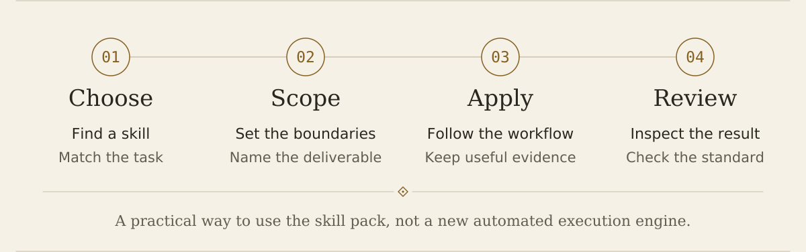

<p align="center"><picture>
  <source media="(prefers-color-scheme: dark) and (max-width: 600px)" srcset="assets/readme-cover-dark-mobile.svg" />
  <source media="(max-width: 600px)" srcset="assets/readme-cover-mobile.svg" />
  <source media="(prefers-color-scheme: dark)" srcset="assets/readme-cover-dark.svg" />
  
</picture></p>

<p align="center"><a href="README.md">English</a> · <a href="README.zh-TW.md">繁體中文</a> · <a href="README.zh-CN.md">简体中文</a></p>

<h1 align="center">Axiom Atropos</h1>

<p align="center"><a href="#begin">選擇工作</a> · <a href="#install">安裝</a> · <a href="#evidence">按證據往前走</a> · <a href="#boundaries">了解界線</a></p>

Axiom Atropos 把 **66 個研究與工程技能** 帶到你正在使用的 agent。從一個問題或一項程式修改開始，選需要的工作流，再核對結果。

**Codex · Claude Code · DeepSeek Harness · Antigravity · Pi**

<p align="center"><picture><source media="(prefers-color-scheme: dark)" srcset="assets/atropos-threshold-dark.svg" /></picture></p>

<a id="begin"></a>
<a id="你現在要做什麼"></a>

## I · 選擇工作

### 研究一個問題

從 [research-suite](skills/research-suite/SKILL.md) 開始，按問題選用文獻檢索、假說設計、統計分析與證據評估技能。

> 使用 Axiom Atropos 研究這個問題，從 research-suite 開始，選用問題需要的技能。

### 修改一段程式

從 [poteto-mode](skills/poteto-mode/SKILL.md) 開始，透過 Pstack 規劃、實作、審查與驗證。

> 使用 poteto-mode 調查這個 bug。先讀相關程式、重現失敗，再說明要如何驗證修正。

需要哪個技能，再讀哪個。不必一次載入全部 66 個。

<p align="center"><picture><source media="(prefers-color-scheme: dark)" srcset="assets/atropos-threshold-dark.svg" /></picture></p>

<a id="install"></a>
<a id="選擇你的使用環境"></a>

## II · 安裝

需要 **Python 3.10+**；Codex、Claude Code 另需各自 CLI。

**Windows · PowerShell**

```powershell
& ([scriptblock]::Create((irm https://raw.githubusercontent.com/xinhi6716/axiom-forge/main/install.ps1))) -Agent codex
```

**macOS / Linux**

```sh
curl -fsSL https://raw.githubusercontent.com/xinhi6716/axiom-forge/main/install.sh | sh -s -- --host codex
```

把 `codex` 換成你使用的主機：

| 主機 | 參數 | 整合方式 |
|---|---|---|
| Codex | `codex` | 原生插件 |
| Claude Code | `claude` | 原生插件 |
| DeepSeek Harness | `deepseek` | 技能目錄 |
| Antigravity | `antigravity` | 技能目錄 |
| Pi | `pi` | 技能目錄 |

**更新：**重跑同一行，Windows 加 `-Update`，macOS/Linux 加 `--update`。完成後重啟或重新載入主機。

上述指令會下載並執行 `main` 上的安裝程式。執行前可先讀[Shell 安裝程式](install.sh)、[PowerShell 安裝程式](install.ps1)與 [Python 轉接程式](scripts/install.py)。

<p align="center"><picture><source media="(prefers-color-scheme: dark)" srcset="assets/atropos-threshold-dark.svg" /></picture></p>

<a id="evidence"></a>

## III · 按證據往前走

選擇工作流，寫清楚要做的檢查，再審閱結果。下圖說明技能包的使用方式，不代表執行環境會強制保證每一步。

<p align="center"><picture>
  <source media="(prefers-color-scheme: dark) and (max-width: 600px)" srcset="assets/atropos-process-dark-mobile.svg" />
  <source media="(max-width: 600px)" srcset="assets/atropos-process-mobile.svg" />
  <source media="(prefers-color-scheme: dark)" srcset="assets/atropos-process-dark.svg" />
  
</picture></p>

<p align="center"><picture><source media="(prefers-color-scheme: dark)" srcset="assets/atropos-threshold-dark.svg" /></picture></p>

<a id="boundaries"></a>
<a id="使用前要知道的事"></a>

## IV · 了解界線

- **技能包含操作指引與輔助程式。** 安裝包不附 Python 環境、第三方 MCP、模型權重或憑證。RSI 提供研究方法，不會替你部署模型或執行環境。

- **各環境的驗證程度不同。** Antigravity 與 Pi 目前只有安裝程式測試，沒有模型對話驗證；檔案放對位置，不代表研究品質已獲驗證。詳見[完整相容性表](docs/compatibility.md)。

- **技能目錄安裝遇到同名衝突或已修改的套件內容會停止。** Codex、Claude Code 則由各自插件管理器維護快取。安裝不修改個人指令、模型設定與 API key。Pi 使用共用技能目錄，其他應用程式也可能讀到它。

**Axiom Lachesis 仍在規劃中。** 此技能包保留原有技能、bridge 與 agent 輔助整合，不附帶該獨立協調器。

<a id="倉庫導覽"></a>
<details>
<summary><strong>倉庫導覽與相容性</strong></summary>

Axiom Atropos 是 Moirai 系列的技能包，前身為 Axiom Forge。倉庫已更名為 `xinhi6716/axiom-atropos`；既有插件識別碼、主機顯示名稱與安裝指令保留 `axiom-forge`，以維持相容性。[名稱與相容性](docs/naming-transition.md)。

```text
skills/             66 個可重用工作流
pstack-resources/   Pstack 共用參考與主機對應
docs/               相容性與維護文件
scripts/            安裝、驗證與打包工具
licenses/           上游著作權與 MIT 聲明
```

[相容性與驗證](docs/compatibility.md) · [維護流程](docs/maintaining.md) · [版本下載](https://github.com/xinhi6716/axiom-atropos/releases)


</details>

---

**[MIT 授權](LICENSE)。** 整合 Lauren Tan 的 Pstack、LIU-31415 的 codex-research 與 K-Dense 科研技能。本專案為獨立整合發行；詳見[來源與授權](licenses/README.md)。
