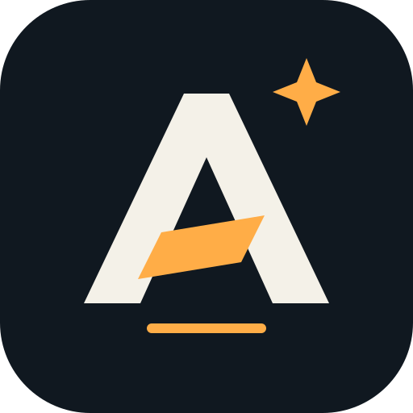

<p align="center">
  
</p>
<h1 align="center">Axiom Forge</h1>
<p align="center"><strong>科研推理，工程驗證。</strong></p>
<p align="center">
  <a href="README.md">English</a> · <a href="README.zh-TW.md">繁體中文</a> · <a href="README.zh-CN.md">简体中文</a>
</p>

<p align="center">
  <a href="LICENSE"></a>
</p>

---

為 **Codex · Claude Code · DeepSeek Harness · Antigravity · Pi** 整合的科研與工程工具箱。

**65 個 skills** — Pstack 工作流、五個科研技能、統一研究入口，以及 RSI 推理方法。

## 安裝

需要 **Python 3.10+**；Codex、Claude Code 另需各自 CLI。

**Windows · PowerShell**

```powershell
& ([scriptblock]::Create((irm https://raw.githubusercontent.com/xinhi6716/axiom-forge/main/install.ps1))) -Agent codex
```

**macOS / Linux**

```sh
curl -fsSL https://raw.githubusercontent.com/xinhi6716/axiom-forge/main/install.sh | sh -s -- --host codex
```

把 `codex` 換成你使用的主機：

| 主機 | 參數 | 整合方式 |
|---|---|---|
| Codex | `codex` | 原生插件 |
| Claude Code | `claude` | 原生插件 |
| DeepSeek Harness | `deepseek` | 技能目錄 |
| Antigravity | `antigravity` | 技能目錄 |
| Pi | `pi` | 技能目錄 |

**更新：**重跑同一行，Windows 加 `-Update`，macOS/Linux 加 `--update`。完成後重啟或重新載入主機。

已有同名 skill 或本機修改時會停止，不直接覆蓋。個人指令、模型設定與 API key 保持原樣。

## 從這裡開始

- **科研 → [research-suite](skills/research-suite/SKILL.md)** — 界定問題、檢索文獻、評估證據、設計假說與分析資料。
- **工程 → [poteto-mode](skills/poteto-mode/SKILL.md)** — 透過 Pstack 規劃、實作、審查與驗證成果。

> 使用 Axiom Forge 研究這個問題，從 research-suite 開始，選用問題需要的技能。

依任務選用技能。RSI 提供迭代研究思路；安裝不會部署模型或執行環境。

## 倉庫導覽

```text
skills/             65 個可重用工作流
pstack-resources/   Pstack 共用參考與主機對應
docs/               相容性與維護文件
scripts/            安裝、驗證與打包工具
licenses/           上游著作權與 MIT 聲明
```

[相容性與驗證](docs/compatibility.md) · [維護流程](docs/maintaining.md) · [版本下載](https://github.com/xinhi6716/axiom-forge/releases)

---

**[MIT 授權](LICENSE)。** 整合 Lauren Tan 的 Pstack、LIU-31415 的 codex-research 與 K-Dense 科研技能。本專案為獨立整合發行；詳見[來源與授權](licenses/README.md)。
