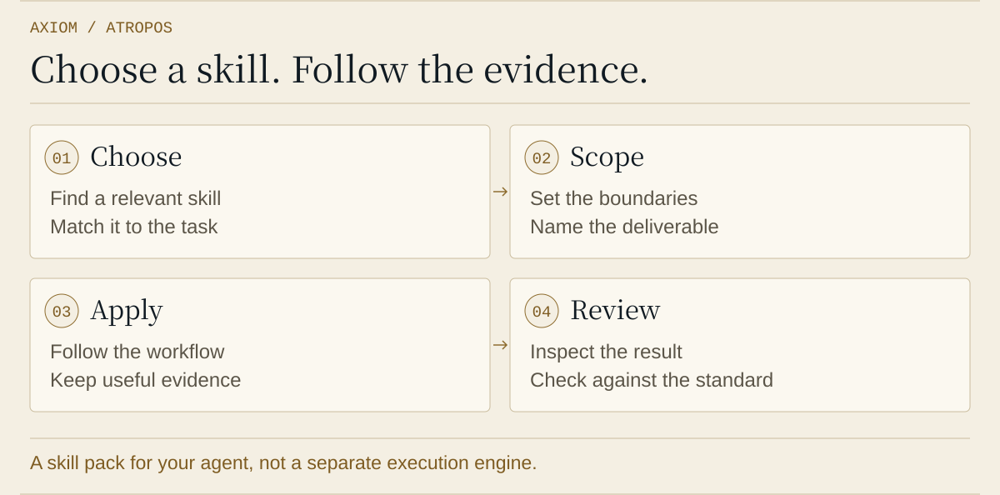

<p align="center"></p>

<h1 align="center"><picture><source media="(prefers-color-scheme: dark)" srcset="https://raw.githubusercontent.com/xinhi6716/xinhi6716/443d48c713f27d52656ad8ea3cb4c5bb9c7dd440/assets/brand-marks/v1/atropos-icon-dark.svg"></picture> Axiom Atropos</h1>

<p align="center"><strong>給現有 agent 使用的研究與工程技能。</strong></p>

<p align="center"><a href="README.md">English</a> · <strong>繁體中文</strong> · <a href="README.zh-CN.md">简体中文</a></p>

<p align="center"><a href="#install">安裝</a> · <a href="#begin">選擇工作流</a> · <a href="#boundaries">使用限制</a></p>

**66 個研究與工程工作流**，用於你現有的 agent。選擇技能、定義檢查，再審閱證據。

| 你要做什麼 | 從這裡開始 |
| --- | --- |
| 研究一個問題 | [Research suite](skills/research-suite/SKILL.md) |
| 修改程式碼 | [Poteto mode](skills/poteto-mode/SKILL.md) |
| 確認主機支援 | [相容性與驗證](docs/compatibility.md) |

<a id="install"></a>
<a id="install-for-your-host"></a>
<a id="選擇你的使用環境"></a>

## 安裝 Rust 預發行版

從[版本下載](https://github.com/xinhi6716/axiom-atropos/releases)取得 Windows x86-64 或 Linux x86-64 套件及 SHA-256 檢查碼。驗證、解壓縮後執行 `bin/atropos install --host codex`（Windows 使用 `bin/atropos.exe`）。支援 `codex`、`claude`、`deepseek`、`antigravity`、`pi`；更新 Claude 時加 `--update`。

原生核心不需要 Python、Node 或 Bun；Codex／Claude 安裝仍需各自主機 CLI。插件識別保留 `axiom-forge`。安裝使用版本化本機 marketplace 或受管理技能目錄，保留使用者修改。請將解壓後的 `bin` 加入 PATH，以使用技能中的原生輔助指令。

從原始碼建置：`cargo build --release --locked`。[完整指令、移植範圍與驗證方式](docs/rust-runtime.md)。

<a id="begin"></a>
<a id="what-are-you-working-on"></a>
<a id="你現在要做什麼"></a>

## 選擇工作流

**研究：**[research-suite](skills/research-suite/SKILL.md) 按問題選用文獻檢索、假說設計、統計分析與證據評估技能。

> 使用 research-suite 研究這個問題。選用需要的技能，說明哪些證據會改變結論。

**工程：**[poteto-mode](skills/poteto-mode/SKILL.md) 以 Pstack 的規劃、實作、審查與驗證流程處理程式修改。

> 使用 poteto-mode 調查這個 bug。先重現失敗，再說明要如何驗證修正。

按需要載入技能，不必一次讀全部 66 個。個別研究技能也可直接使用，不是每個任務都需要協調器。

<a id="evidence"></a>
<details>
<summary><strong>流程與進階工具</strong></summary>

<p align="center"><picture>
  <source media="(prefers-color-scheme: dark) and (max-width: 600px)" srcset="assets/atropos-process-dark-mobile.svg" />
  <source media="(max-width: 600px)" srcset="assets/atropos-process-mobile.svg" />
  <source media="(prefers-color-scheme: dark)" srcset="assets/atropos-process-dark.svg" />
  
</picture></p>

[Native bridge](bridge/README.md) and [agents](agents/) support compatible hosts. The Rust core needs only its backend CLIs. Optional upstream scientific, watcher and statechart helpers retain Python / Node / Java requirements; see the [migration boundary](docs/rust-runtime.md).

</details>

<a id="boundaries"></a>
<a id="before-you-rely-on-it"></a>
<a id="使用前要知道的事"></a>

## 狀態與限制

- 技能包含指引與輔助程式；安裝不提供 Python、第三方 MCP server、模型權重或憑證。RSI 是研究方法，不是已部署模型或自我進化執行環境。
- 各主機驗證程度不同。Antigravity 與 Pi 只有安裝程式測試，沒有模型對話驗證。詳見[相容性表](docs/compatibility.md)。
- 技能目錄安裝遇到同名衝突或已修改的套件內容會停止。原生插件管理器維護各自快取；不修改個人指令、模型設定或 API key。其他應用程式也可能讀取 Pi 的共用技能目錄。

**Lachesis 仍在規劃中。** 它是獨立協調器，不是本技能包已附帶的功能。

<a id="inside-the-repository"></a>
<a id="倉庫導覽"></a>
<details>
<summary><strong>倉庫導覽</strong></summary>

```text
skills/             66 reusable workflows
pstack-resources/   Shared Pstack references and host mappings
src/                Native Rust CLI, bridge, memory and orchestration
docs/               Compatibility and maintenance
tests/              Native integration tests and compatibility oracles
licenses/           Upstream copyright and MIT notices
```

[維護流程](docs/maintaining.md) · [來源版本](sources.json) · [版本下載](https://github.com/xinhi6716/axiom-atropos/releases)

</details>

---

[MIT 授權](LICENSE) · [來源與授權](licenses/README.md) · [素材聲明](assets/ASSET_NOTICES.txt)

本專案獨立整合 Lauren Tan 的 Pstack、LIU-31415 的 codex-research 與 K-Dense 科研技能。Atropos 是 Axiom 旗下 Moirai 系列的技能包。

